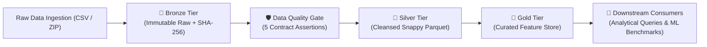

# Technical Documentation & System Deep Dive: AutoML Studio (`AIMiniProject`)

> **Comprehensive Technical Specification, Machine Learning Architecture, & Security Manual**

---

## 📖 Table of Contents
1. [Architectural Overview & Principles](#1-architectural-overview--principles)
2. [Leakage-Conscious Model Evaluation](#2-leakage-conscious-model-evaluation)
3. [Machine Learning Pipeline & Model Registry](#3-machine-learning-pipeline--model-registry)
4. [Database & Persistence Architecture](#4-database--persistence-architecture)
5. [Inference Engine & Live Playground API](#5-inference-engine--live-playground-api)
6. [Model Serialization & Export Specifications](#6-model-serialization--export-specifications)
7. [Security & Hardening Audit](#7-security--hardening-audit)
8. [End-to-End Workflow Walkthrough](#8-end-to-end-workflow-walkthrough)

---

## 1. Architectural Overview & Principles

AutoML Studio follows a **decoupled client-server architecture**:

* **Backend Services**: Built on FastAPI with Pydantic request validation and SQLAlchemy persistence for accounts and training history.
* **Frontend Client**: Built on **React 19** with **Vite**, utilizing Axios interceptors for automatic JWT Bearer token attachment and centralized state management via React Context (`AppContext` & `AuthContext`).
* **Machine Learning Engine**: Designed around modular Scikit-Learn `Pipeline` and `ColumnTransformer` constructs, combined with **XGBoost** and **LightGBM** gradient boosted decision trees.

---

## 2. Leakage-Conscious Model Evaluation

In machine learning, **Data Leakage** occurs when information from outside the training dataset (such as test set statistics) is inadvertently used to fit preprocessors or train models.

### Problem in Naive Implementations:
In basic implementations, functions like `StandardScaler.fit_transform(X)` or `SimpleImputer.fit_transform(X)` are called on the **entire dataset** prior to splitting into train and test sets. This leaks the mean, standard deviation, and categorical values of test samples into training, causing artificially inflated metrics.

### Current implementation:
1. Raw features ($X$) and target ($y$) are separated without modifying feature values.
2. Dataset is split into $X_{\text{train}}, X_{\text{test}}, y_{\text{train}}, y_{\text{test}}$ using `split_data()`.
3. An **unfitted** `ColumnTransformer` is created for numerical (imputation + scaling) and categorical (imputation + one-hot encoding) columns.
4. A full `sklearn.pipeline.Pipeline` is assembled:
   $$\text{Pipeline} = \text{ColumnTransformer} \longrightarrow \text{Estimator}$$
5. The pipeline is fitted **strictly on $X_{\text{train}}$** during `pipeline.fit(X_train, y_train)`.
6. Models are ranked by cross-validation scores on the training split. Holdout metrics are reported for the selected model using $X_{\text{test}}$. Scores vary with the split, dataset size, and chosen metric; this process does not guarantee generalization.
7. Image reference columns are treated as display metadata and excluded from model features. The model does not analyze image pixels. A “top predicted item” is meaningful only for regression targets or numeric/ordered class labels.

---

## 3. Machine Learning Pipeline & Model Registry

AutoML Studio supports both **classification** and **regression** task auto-detection.

### Classification Task Registry:
* **Logistic Regression**: Linear boundary classifier (`C`, `max_iter` tuning).
* **Decision Tree Classifier**: Non-linear tree partitioning (`max_depth`, `min_samples_split`).
* **Random Forest Classifier**: Ensemble of randomized decision trees (`n_estimators`, `max_depth`).
* **KNN Classifier**: Instance-based k-nearest neighbors (`n_neighbors`).
* **XGBoost Classifier** (`XGBClassifier`): Gradient boosted decision trees optimized for speed and accuracy.
* **LightGBM Classifier** (`LGBMClassifier`): Leaf-wise tree growth gradient boosting.

### Regression Task Registry:
* **Linear Regression**: Ordinary least squares linear regression.
* **Decision Tree Regressor**: Non-linear regression tree.
* **Random Forest Regressor**: Ensemble regression trees.
* **KNN Regressor**: Instance-based regression.
* **XGBoost Regressor** (`XGBRegressor`): Gradient boosted regression trees.
* **LightGBM Regressor** (`LGBMRegressor`): Leaf-wise tree growth regression.

---

## 4. Database & Persistence Architecture

Account and training-history persistence is managed by SQLAlchemy connecting to SQLite (`backend/data/automl_studio.db`). Uploaded datasets, images, and fitted pipelines live in a process-local memory session. They are lost on restart, and the app currently requires a single API process.

### Database Schema (ERD):

```
+-----------------------------------+       +-----------------------------------+
|               users               |       |           model_history           |
+-----------------------------------+       +-----------------------------------+
| id (PK)         : String (UUID)   |       | id (PK)         : String (UUID)   |
| username        : String (Unique) |       | username        : String (indexed) |
| hashed_password : String          |       | model_name      : String          |
| created_at      : DateTime        |       | target_column   : String          |
+-----------------------------------+       | problem_type    : String          |
                                            | primary_score   : Float           |
                                            | metrics         : JSON            |
                                            | parameters      : JSON            |
                                            | timestamp       : DateTime        |
                                            +-----------------------------------+
```

---

## 5. Inference Engine & Live Playground API

The backend exposes a dedicated live prediction endpoint (`POST /predict`):

```json
// POST /predict Request Payload
{
  "features": {
    "age": 32,
    "income": 75000,
    "education": "Bachelors"
  }
}
```

### Processing Logic:
1. Retrieves the active trained `Pipeline` object from the user's isolated session.
2. Transforms raw input JSON into a single-row Pandas DataFrame.
3. Passes the raw DataFrame directly to `pipeline.predict(input_df)`. The embedded `ColumnTransformer` automatically imputes, encodes, and scales input feature values.
4. If a target `LabelEncoder` exists, automatically decodes numeric outputs back to human-readable strings.
5. Computes class probabilities (`predict_proba`) if supported by the underlying estimator.

---

## 6. Model Serialization & Export Specifications

AutoML Studio packages full pipelines using **Joblib**. Joblib uses pickle-based serialization, so load only exports from sources you trust:

```python
export_package = {
    "pipeline": fitted_pipeline,       # Complete Pipeline (ColumnTransformer + Model)
    "model_name": model_name,         # Display name of the algorithm
    "target_column": target_col,      # Target feature name
    "problem_type": problem_type,     # Classification / Regression
    "raw_feature_columns": raw_cols,   # Input feature schema list
    "label_encoder": label_encoder,   # Target LabelEncoder for classification
}
joblib.dump(export_package, buffer)
```

### Downstream Consumption Example:
```python
import joblib
import pandas as pd

# Load only a trusted exported pipeline package
package = joblib.load("random_forest_pipeline.joblib")
pipeline = package["pipeline"]

# Run inference on new unseen data
df_new = pd.DataFrame([{"age": 28, "salary": 62000}])
prediction = pipeline.predict(df_new)
print("Prediction:", prediction)
```

---

## 7. Security & Hardening Audit

1. **File Upload Size Ceiling**: Enforces a 50MB maximum size limit per upload to prevent memory exhaustion DoS attacks.
2. **Multi-Encoding Parser**: Tries `utf-8` and falls back to `latin1` to handle messy real-world CSV files without crashing.
3. **Bcrypt Password Hashing**: Passwords are hashed with Passlib before database persistence.
4. **JWT Expiration & Verification**: Access tokens signed using `HS256` with configurable expiration.

---

## 8. End-to-End Workflow Walkthrough

1. **User Auth**: Sign up/login to obtain JWT token.
2. **Upload**: Post a CSV, or a ZIP containing one CSV and associated images, to `/upload`.
3. **Analyze**: View statistical summaries (null counts, dtypes, missing values) at `/analyze`.
4. **Configure & Train**: Submit configuration to `/train` or `/compare`.
5. **Evaluate**: Inspect accuracy, F1, precision, recall, confusion matrix, or R² / RMSE on the UI.
6. **Playground Inference**: Test live custom inputs on the Interactive Live Inference Playground.
7. **Export**: Download the fitted `.joblib` model package for trusted local use.

---

## 9. Data Engineering Architecture: Medallion Lakehouse & Quality Gate Engine

AutoML Studio implements an enterprise **Medallion Data Lakehouse Pipeline** with automated **Data Quality Contracts** and **Apache Parquet Columnar Storage**. In this architecture, Machine Learning is treated as a downstream consumer validating pipeline signal retention.



### 9.1 Lakehouse Storage Tiers
* **Bronze Tier (Raw Landing)**: Ingests raw CSV payloads, computes cryptographic SHA-256 payload checksums for lineage auditability, and stores an immutable record in `backend/storage/bronze/`.
* **Silver Tier (Cleansed Parquet)**: Cleanses incoming batches by purging duplicate rows, imputing missing values, standardizing schema names to `snake_case`, and serializing to **Apache Parquet with Snappy compression** (saving up to ~75% disk space).
* **Gold Tier (Curated Feature Store)**: Encodes categoricals, scales feature distributions, and structures the curated feature matrix in `backend/storage/gold/` ready for analytical SQL queries or downstream consumers.

### 9.2 Automated Data Quality Gate & Contracts
Before promotion into the Silver layer, every dataset is audited against 5 data engineering contract assertions:
1. **Completeness Threshold**: Validates overall dataset completeness ratio ($\ge 80\%$) and flags high-null columns ($>30\%$).
2. **Uniqueness Assertion**: Detects duplicate records and computes duplicate percentage.
3. **Schema Contract**: Enforces column naming conventions and verifies inferred datatypes.
4. **Anomaly Range Profiling**: Identifies numeric outliers using interquartile range (IQR) bounds.
5. **Quality Scorecard**: Aggregates rule evaluations into a 0–100% Quality Score and assigns a promotion verdict (`PROMOTED_TO_SILVER`, `PROMOTED_WITH_WARNINGS`, or `QUARANTINE_FLAGGED`).

### 9.3 Columnar Storage Exports
Users can directly stream and download lakehouse tiers in modern analytical formats:
* `GET /de/download/silver` $\rightarrow$ Streams `silver_cleaned.parquet`.
* `GET /de/download/gold` $\rightarrow$ Streams `gold_feature_store.parquet`.
* `GET /de/lakehouse-metrics` $\rightarrow$ Live storage telemetry (raw bytes, parquet bytes, compression ratio).

---

## 10. Data Engineering Project Defense & Viva Talking Points

| Evaluator Question | Data Engineering Defense |
|---|---|
| **"What makes this a Data Engineering project rather than pure ML?"** | *"The primary focus is data ingestion, schema validation, multi-tier lakehouse storage (Bronze $\rightarrow$ Silver $\rightarrow$ Gold), and columnar Parquet optimization. Machine learning serves merely as a downstream validator to prove that our feature pipeline preserved signal without data leakage."* |
| **"Why Medallion Architecture?"** | *"Medallion separates raw ingestion (Bronze) from cleansed data (Silver) and business-ready features (Gold). This ensures auditability, prevents raw data loss, and enables different downstream consumers to query the appropriate tier."* |
| **"Why convert from CSV to Apache Parquet?"** | *"CSVs are row-oriented, uncompressed, and lack schema enforcement. Apache Parquet uses columnar storage with Snappy compression, significantly reducing I/O, speeding up analytical aggregate queries, and reducing disk footprint by ~70%."* |
| **"How do you enforce Data Quality?"** | *"The pipeline runs an automated gatekeeper verifying completeness, uniqueness, and schema sanity. If duplicate rows or excessive missing values are detected, automated remediation cleanses the data during Silver tier promotion."* |
